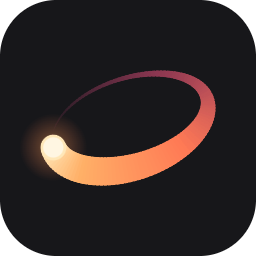
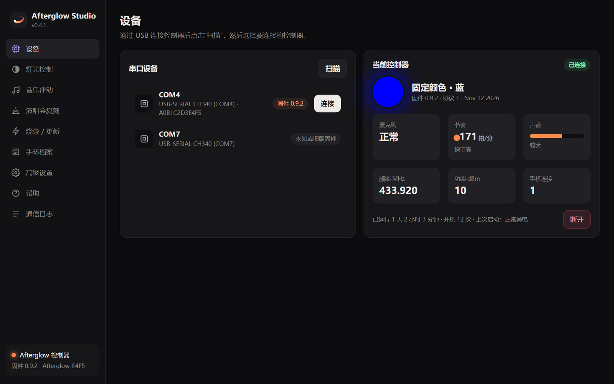
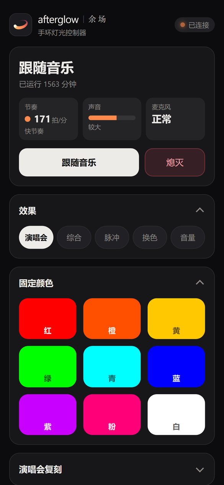
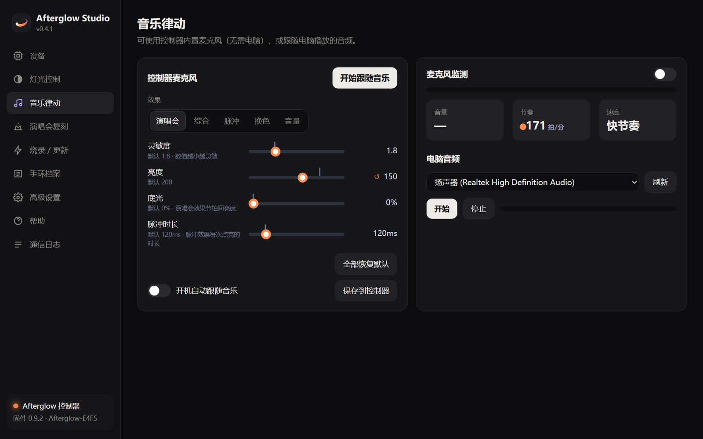
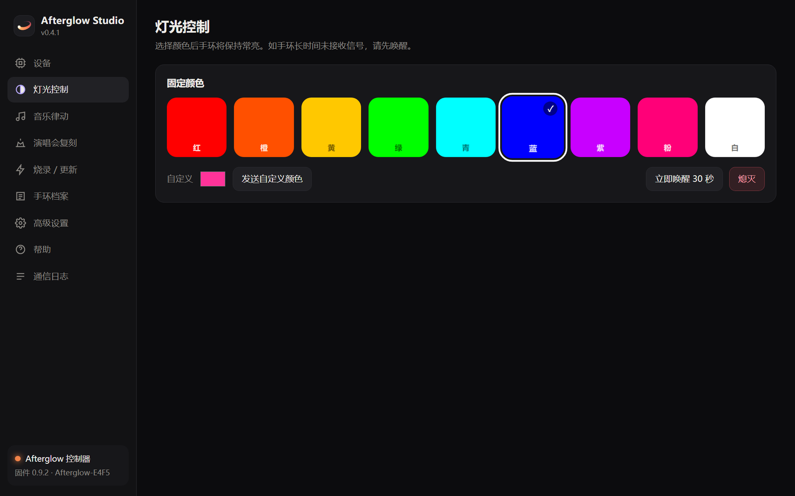
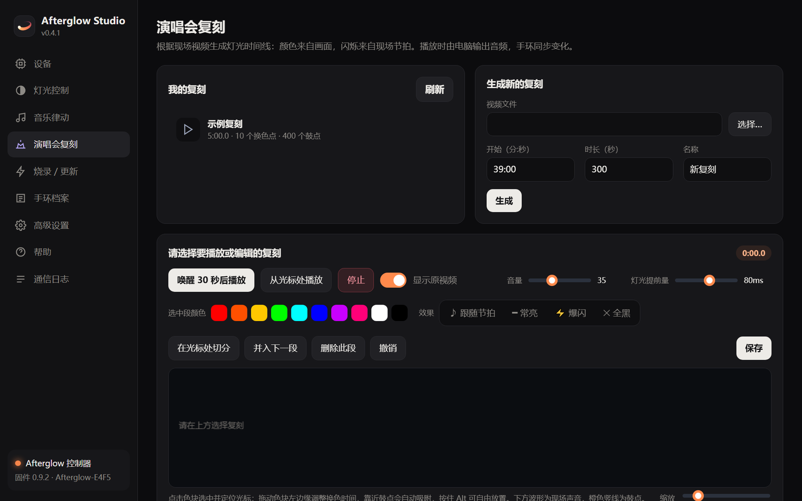
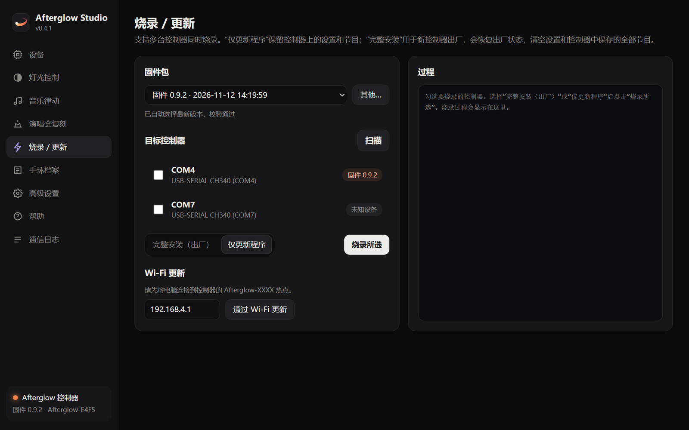
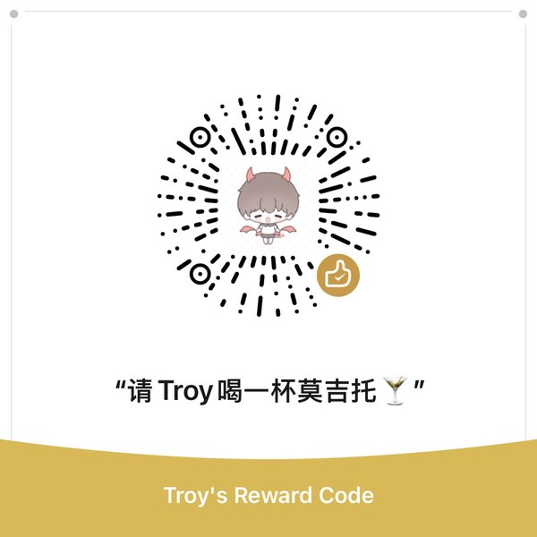

# Afterglow 余场

**让演唱会带回来的 433 MHz 荧光手环，在家里重新亮起来。**

[**下载**](https://github.com/Trovoy/afterglow/releases/latest) · [**DIY 指南**](docs/DIY指南.md) · [常见问题](docs/常见问题.md) · [更新日志](CHANGELOG.md)

---

## 这是什么

演唱会散场后，手里的荧光手环就再也不会亮了。Afterglow 余场是一个自己就能做的小控制器：花约 70 元买三个现成模块，插几根线，不用焊接，就能用手机或电脑让这些手环重新亮起来，还能跟着音乐闪。

- **手机直接控制**：控制器自带 Wi-Fi 热点，手机连上就能用，不用装 App、不用联网；
- **跟着音乐闪**：接上麦克风模块，手环会跟着现场音乐的节拍闪烁；
- **电脑端 Afterglow Studio**：一键刷固件，调颜色和效果，还能用你自己拍的演唱会视频生成"复刻"灯光，回放时手环跟着变色。

> 不想自己动手？闲鱼搜「Afterglow 余场」，有装好、测好的成品。

## 截图

<table>
<tr>
<td width="68%"></td>
<td width="32%" rowspan="2"></td>
</tr>
<tr>
<td></td>
</tr>
</table>

更多截图

| 灯光控制 | 演唱会复刻 | 烧录 / 更新 |
| --- | --- | --- |
|  |  |  |

## 三步做一台

完整步骤见 **[DIY 指南](docs/DIY指南.md)**（也有 [PDF 版](https://github.com/Trovoy/afterglow/releases/latest)，可以打印）。

1. **买东西**：淘宝一键加购，约 70 元；
2. **接线**：照着接线图插杜邦线，同颜色、同数字连起来；
3. **刷机点亮**：电脑装 Afterglow Studio 刷固件，手机连热点，点颜色。

## 下载

到 **[Releases 页面](https://github.com/Trovoy/afterglow/releases/latest)** 下载最新版：

| 文件 | 是什么 |
| --- | --- |
| `Afterglow-Studio-x.y.z-Windows.zip` | 电脑端软件，里面已经带了最新固件 |
| `afterglow-fw-x.y.z.zip` | 控制器固件（Studio 里已自带，一般不用单独下载） |
| `Afterglow-DIY-Guide.pdf` | 可打印的 DIY 指南 |
| `SHA256SUMS.txt` | 文件校验值 |

GitHub 下载慢的话，可以多试几次，或者用手机热点下载。

**安装：** 解压 → 双击「安装 Afterglow Studio.cmd」。Windows 弹出「Windows 已保护你的电脑」时，点 **更多信息 → 仍要运行**。软件没有做付费代码签名，所以会有这个提示。

## 系统要求

- Windows 10 / 11（64 位）
- 一根能传数据的 USB Type-C 线
- 手机：任意能连 Wi-Fi 的手机，用自带浏览器就行
- 手环：433 MHz 的演唱会荧光手环（换上新的纽扣电池）

## 有效距离

控制器到手环**约 1 米**（实测 0.7～1.3 米，看手环朝向和房间摆放）。天线一定要拧上；手环戴在手上或立着比平放在桌上收得好。详见 [常见问题](docs/常见问题.md#距离为什么只有-1-米左右)。

## 问题反馈

遇到问题先看 [常见问题](docs/常见问题.md)。还解决不了，请到 [Issues](https://github.com/Trovoy/afterglow/issues/new/choose) 提交，写清楚软件版本、固件版本和做了什么操作。

## 支持作者

这个项目是业余时间做的，固件和指南免费分享。觉得有用，可以请作者喝一杯 🍹

## 免责声明

本项目按现状免费提供，**仅供演出结束后、在私人场合控制自己持有的手环**，严禁在演唱会和活动现场使用。本项目与任何手环厂商、演出主办方和艺人均无关联，不提供任何演唱会节目、音频或视频。使用者须自行遵守所在地的无线电管理规定。完整条款见 [DIY 指南 · 免责声明](docs/DIY指南.md#免责声明)。

## 许可

软件和固件**免费供个人非商业使用**，不开放源代码；文档和图片按 CC BY-NC-SA 4.0 共享。详见 [LICENSE](LICENSE.md)。

本项目用到的开源组件和参考资料见 [THIRD_PARTY_NOTICES.txt](THIRD_PARTY_NOTICES.txt)。
