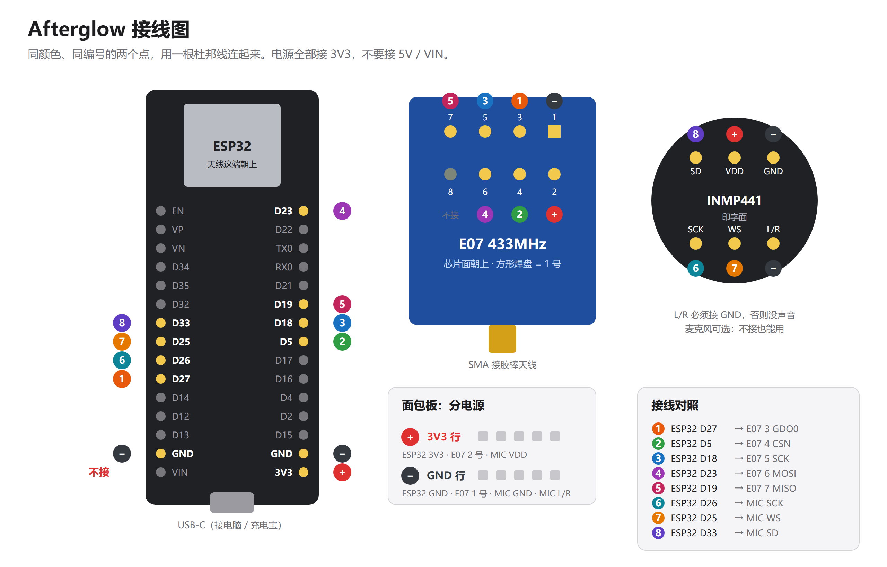

# DIY 指南：自己做一台 Afterglow

不用焊接，插几根线，让演唱会带回来的 433 MHz 手环重新亮起来。**总共 3 步，大约半小时。**

---

## 第 1 步　准备零件

| 零件 | 要求 | 说明 |
| --- | --- | --- |
| ESP32 开发板 | 经典 ESP32（ESP32-WROOM-32），30 针，USB 芯片 CH340，Type-C 接口，已焊排针 | ESP32-C3、S3、S2、Super Mini 等型号**不支持** |
| 433 MHz 射频模块 | 亿佰特 E07-M1101D-SMA（CC1101），带 SMA 胶棒天线 | 天线必须装上 |
| 数字麦克风（可选） | INMP441 模块，I²S 接口 | 不接也能用；接上后手环能跟着音乐闪 |
| 杜邦线 | 20 cm，母对母、公对母各若干 | |
| 面包板 | 400 孔 | 用来给 3V3 和 GND 分线 |
| 数据线 | 能传数据的 USB Type-C 线 | 只能充电的线刷不了机 |

---

## 第 2 步　接线（先别插电）

照着图，**同颜色、同数字的两个点，用一根线连起来。**

- ESP32 每根针旁边都印着名字，**按名字找**；
- 红色 ＋ 都接 **3V3**，黑色 － 都接 **GND**：先插到面包板的同一行，再从那一行分出去；
- ⚠️ **千万别接 5V 或 VIN**，会烧坏射频模块；
- 麦克风没买，就不用接 6、7、8。

---

## 第 3 步　刷机、连手机、点亮

1. **刷机**：到 [Releases](https://github.com/Trovoy/afterglow/releases/latest) 下载 **Afterglow Studio 安装程序**（`Afterglow-Studio-Setup-….exe`），双击安装后打开，会弹出新手引导：用数据线插上 ESP32，点「刷入固件」，等 1 分钟。
2. **连手机**：手机 Wi-Fi 连 **Afterglow-XXXX**，密码 **`afterglow88`**，控制页面会自己弹出来（没弹就在浏览器打开 `192.168.4.1`）。
3. **点亮**：手环装上新电池，放在旁边。按页面提示做一次「频率适配」，点「唤醒」等 30 秒，再点颜色。🎉

---

## 不亮怎么办

1. 先**换新电池**，旧电池是最常见的原因；
2. 天线**拧紧**，手环**立起来或戴在手上**，别平放在桌上；
3. 离近一点，**1 米以内**最稳；某个位置不亮，挪几十厘米再试；
4. 重新做一次「频率适配」；
5. 还不行，对着接线图把 1～5 号线再检查一遍。

更多问题见 [常见问题](常见问题.md)。

---

## 免责声明

1. **按现状提供。** 本说明和固件免费提供，不保证没有错误，也不保证适用于你的手环或设备。
2. **风险自负。** 接错线（尤其是接到 5V）、短路、劣质线材或电源，可能损坏模块、开发板、电脑 USB 口或手环，作者不承担责任。
3. **无线电使用。** 本设备在 433 MHz 频段发射信号。使用者须自行遵守所在地的无线电管理规定，不得干扰其他合法无线电业务；一旦造成干扰，应立即停止使用。
4. **不得在演出现场使用。** 仅供演出结束后、在私人场合控制**自己持有**的手环。**严禁在演唱会、活动现场使用**，以免干扰主办方灯光和其他观众。
5. **非官方产品。** 本项目与任何手环厂商、演出主办方、艺人均无关联，也未获其授权或认可。
6. **内容版权。** 本项目不提供任何演唱会节目、音频或视频。使用「复刻」功能时，视频和音频由你自行提供，请确保你有权使用。
7. **电池安全。** 更换纽扣电池时放在儿童接触不到的地方，误吞纽扣电池非常危险。
8. **仅限个人使用。** 固件和软件仅供个人非商业使用。未经作者书面许可，不得出售，不得预装在出售的设备中，也不得修改后重新发布。
9. **隐私。** 控制器只在本地开启自己的 Wi-Fi 热点，不连接互联网，不收集任何个人数据。

在法律允许的最大范围内，作者不对因使用或无法使用本项目造成的任何直接或间接损失承担责任。组装或使用本设备，即表示你已阅读并同意以上内容。
